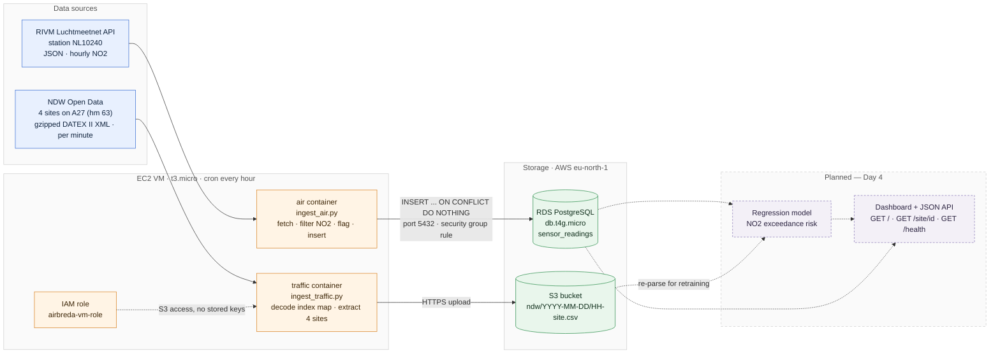

# AirBreda — Architecture Design Document

**Author:** Yuliia Medun
**Course:** System Design & Cloud Platforms, Year 3 ADSAI
**Cloud provider:** AWS (`eu-north-1`)

---

## 1. Problem statement

We want to understand whether traffic congestion at the A27 interchange near Breda
causes air quality exceedances nearby. This document records the design of the cloud
platform that ingests live NO₂ readings (RIVM Luchtmeetnet station NL10240) and live
vehicle counts (four NDW measurement sites at that interchange), stores and processes
them, and serves an ML model predicting NO₂ exceedance risk in the next hour.

---

## 2. Architecture diagram

## 2. Architecture diagram

---

## 3. Trade-off analysis

_AirBreda-specific. Reference the ADRs rather than repeating them._

---

## 4. Cloud provider rationale

_Written for a municipal, non-technical audience._

---

## 5. Cost estimate

| Scenario | Monthly cost | Notes |
|---|---|---|
| 10 corridors | | |
| 50 corridors | | |

---

## 6. Reflection

_What would you do differently?_

---

## Architecture Decision Records

- [ADR-001 — Initial Data Storage Strategy](adr/ADR-001-storage-strategy.md)
