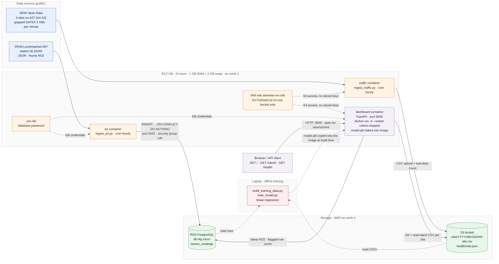

# Architecture Design Document

**Author:** Yuliia Medun  
**Course:** System Design & Cloud Platforms, Year 3 ADSAI  
**Cloud provider:** AWS (`eu-north-1`, Stockholm)  

AirBreda is a small cloud platform for the Municipality of Breda that collects two live open-data streams every hour: NO₂ readings from RIVM Luchtmeetnet station NL10240, and vehicle counts from four NDW measurement sites at the A27 interchange near Breda. It stores both, trains a simple regression model that estimates the current hour's NO₂ from traffic and time of day, and serves the readings, the prediction and an exceedance risk on a public dashboard and JSON API.

---

## Contents

1. [Full AirBreda Architecture Diagram](#diagram)
2. [Architecture Decision Records](#adrs)
   - [ADR-001: Initial Data Storage Strategy](#adr-001)
   - [ADR-002: Messaging Architecture](#adr-002)
   - [ADR-003: Resilience Strategy](#adr-003)
   - [ADR-004: Compute Strategy](#adr-004)
   - [ADR-005: Compute & Deployment Strategy](#adr-005)
   - [ADR-006: ML Serving Architecture](#adr-006)
3. [Trade-Off Justifications](#tradeoffs)
4. [Cloud Provider Rationale for a Municipal Audience](#cloud-provider)
5. [Cost Estimate](#cost)
6. [Reflection](#reflection)

---

## 1. Full AirBreda Architecture Diagram

The system as deployed on Day 4, including which credentials give access to what (trust boundaries).

**Trust boundaries.** The VM reaches S3 only through its IAM role, limited to upload, download and list on one bucket. It reaches the database with a password stored in `.env` on the VM, and the database accepts connections only from the VM's security group and my own IP. Port 8000 is the only port open to the public.

> Day 2's Redis queue is not part of this deployment. Both ingestion containers write directly to RDS and S3 (see ADR-004).

---

## 2. Architecture Decision Records

| ADR | Topic |
|---|---|
| [ADR-001](#adr-001) | Initial Data Storage Strategy (Day 1) |
| [ADR-002](#adr-002) | Messaging Architecture (Day 2) |
| [ADR-003](#adr-003) | Resilience Strategy (Day 2) |
| [ADR-004](#adr-004) | Compute Strategy (Day 3) |
| [ADR-005](#adr-005) | Compute & Deployment Strategy (Day 4), extends ADR-004 |
| [ADR-006](#adr-006) | ML Serving Architecture (Day 4) |



---



---



---



---



---



---

## 3. Trade-Off Justifications

**Storage type (ADR-001).** I chose PostgreSQL on RDS for NO₂ readings and S3 for traffic files instead of NoSQL. The data is structured, the main queries use time ranges, and I need to join NO₂ and traffic by hour. The expected volume (1–2 million rows over five years) is small enough for a basic RDS instance. I use a composite key and ON CONFLICT DO NOTHING to prevent duplicates. The trade-off is less flexibility and losing some traffic details because I store parsed CSV files instead of the original XML.

**Compute choice (ADR-004, ADR-005).** I chose one t3.micro VM running three containers instead of a managed service like ECS or App Runner. It costs around $7.88 per month and is simpler to manage. However, all containers share 1 GB of RAM. Memory drops to around 50 MB during traffic ingestion, and I had to add 2 GB of swap after the container ran out of memory on Day 3. If the VM stops, the whole system goes down.

**Messaging pattern (ADR-002).** I chose direct writes instead of a Redis queue. With only one producer and consumer per source, a queue would add unnecessary complexity. The downside is that failed writes are not buffered. Missing NO₂ data can usually be recovered by the next run, which fetches the last 10 hours. Missing NDW traffic snapshots cannot be recovered.

**DR strategy (ADR-003).** I chose Backup & Restore with a 99% availability target, allowing 7.2 hours of downtime per month. I rely on RDS backups, GitHub and S3 to rebuild the system manually if the VM fails. The targets are 2 hours to restore the system (RTO) and up to 1 hour of data loss (RPO). Warm Standby could reduce recovery to 15 minutes, but would cost around $51 instead of $27 per month, which I don't think is necessary.

---

## 4. Cloud Provider Rationale for a Municipal Audience

*Written for a policy officer at the Municipality of Breda.*

AirBreda runs on Amazon Web Services (AWS), a company that provides rented computing power and storage. Instead of buying and maintaining its own servers, the municipality can rent what it needs and pay monthly. Currently, AirBreda uses one small server, one database and one storage service, costing [EDIT: monthly total].

What AWS offers. AWS provides ready-to-use services. It manages database backups and maintenance, stores files without us managing physical disks, and allows us to increase or decrease resources when needed. If AirBreda grows to cover more locations, we can simply rent more capacity instead of buying new hardware.

Why it suits this project. All AirBreda data is stored in Stockholm, within the EU, so European data-protection rules apply. The data consists of public air-quality and traffic measurements, with no personal information. AWS also has security certifications that the municipality can review.

One thing to consider is that AWS is an American company. This isn't a major concern for the current public data, but for future projects involving personal information, a European provider or stricter contract terms might be preferable.

What happens if we switch providers? AirBreda uses standard technologies: Docker containers, PostgreSQL and plain-text files. This makes moving to another provider possible without rebuilding everything from scratch. However, it would still require some technical work and testing, and we would lose the AWS setup and experience we've already built. The monthly cost could also change.

---

## 5. Cost Estimate

On-demand prices for region `eu-north-1` (Stockholm), 730 hours per month, converted at 1 USD = €0.86 (November 2026). Instance sizes are my own choices for each scale.

| Component | Current (1 corridor) | At 10 corridors | At 50 corridors |
|---|---|---|---|
| Compute (VM) | €6.78/month (`t3.micro`, 1 GB) | €13.56/month (`t3.small`, 2 GB) | €27.12/month (`t3.medium`, 4 GB) |
| Database | €10.32/month (`db.t4g.micro`) | €10.32/month (`db.t4g.micro`) | €20.64/month (`db.t4g.small`) |
| Object storage | < €0.01/month (a few MB of CSVs) | < €0.01/month (~40 MB/year) | €0.05/month (~2.5 GB/year) |
| **Total** | **≈ €17/month** | **≈ €24/month** | **≈ €48/month** |

**Assumptions.** Ten corridors means about 40 traffic sites ingested hourly. Fifty corridors means about 200 sites ingested every 5 minutes, as in the ADR-004 scenario. Each traffic CSV is about 120 bytes. The table leaves out the VM's disk, the database's storage, S3 requests and data transfer, which add a few euros a month at these volumes. I kept the database at `db.t4g.micro` for 10 corridors because even 10 stations produce only about 1.3 million rows a year, and moved it to `db.t4g.small` at 50 corridors for the extra memory under writes every 5 minutes.

**At 10 corridors,** a single VM is still the right choice, but not the current one. The 1 GB `t3.micro` already drops to about 50 MB of free memory during each hourly traffic run, so a 2 GB `t3.small` is the minimum, and an hourly run over 40 sites still fits comfortably within the hour.

**At 50 corridors,** a single VM is no longer the right choice. With 200 sites every 5 minutes, a run would take longer than the 5 minutes between runs, so runs would overlap and compete for memory. The `t3.medium` price above shows what one larger VM would cost, but the better design spreads ingestion over several containers on a managed service (see ADR-004 and ADR-005), which would cost more than this table shows.

---

## 6. Reflection

The architectural decision I'm least confident in is running the whole system on one small VM. On Day 3 the traffic container was killed for lack of memory until I added a swap file, and on Day 4 free memory dropped to about 50 MB every time the hourly traffic job ran. Once, the dashboard restarted on its own, and I couldn't find out why: the kernel log showed no out-of-memory kill at that moment. I chose the VM because it was simple and cheap, but I can't fully explain how it behaves under load, which makes it hard to defend. To become confident, I would need several weeks of monitoring data: memory and CPU over time, how often the dashboard slows down or restarts, and whether those events line up with the cron runs. With that evidence I could decide whether a larger VM is enough or whether the dashboard needs its own resources.

My regression model was trained on 47 joined hours, and on 10 held-out hours it scored a test R² of −0.30, meaning it predicted worse than simply guessing the average. With a full year of readings, almost everything about it would change. The data would cover weekdays and weekends, holidays and all four seasons, so I could add features that likely matter more than traffic, such as wind speed and direction, temperature and the previous hour's NO₂. I would treat the hour of day as a cycle, so the model knows 23:00 and 00:00 are neighbours. I would evaluate with a time-based split, training on earlier months and testing on later ones, because that matches how the model is used. With enough data, a non-linear model such as gradient boosting would be worth testing, and the exceedance risk could come from a classifier trained on real exceedance hours instead of a sigmoid on the regression output.

If AirBreda served the municipality for real, the first thing I would add is an automated deployment pipeline (CI/CD) with the infrastructure described as code. Every change on Day 4 was deployed by hand: copying files to the VM, rebuilding images there and replacing containers. That caused real mistakes. A duplicate `/health` route silently overrode the new one, a scikit-learn version mismatch was only caught because I happened to test with Docker Compose first, and I rebuilt images on the 1 GB VM while the hourly job was running. A pipeline that runs the tests, builds each image once and deploys it the same way every time would have caught or avoided all three. Describing the VM, database, bucket, IAM role and firewall rules as code would also let me rebuild the whole system from the repository if the VM were lost, which reduces the single-VM risk I'm least confident about.

<!-- Draws the Mermaid diagram on GitHub Pages. github.com draws it on its own and ignores this. -->

